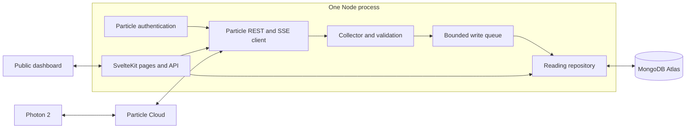

# Architecture

## Runtime and boundaries

This is one SvelteKit application with a persistent Node server, built by `@sveltejs/adapter-node`. It is not a static site or serverless collector. Pages and API handlers use a shared server runtime; browsers never connect to Particle or MongoDB directly.

`hooks.server.ts` starts the runtime in SvelteKit’s server `init` hook. With adapter-node this runs during process startup, before the first browser request. It is skipped during build analysis. `runtime.ts` shares the same initialization promise across all routes; it does not open subscriptions per visitor. Vite hot disposal closes the development runtime. In production, the adapter’s `sveltekit:shutdown` event stops collection, drains writes within a budget, and closes MongoDB.

The application starts even if Particle or MongoDB is temporarily unavailable. Invalid live configuration fails at startup. Particle connection attempts retry in the background; unavailable database reads return a sanitized 503 response.

## Modules

| Module                                     | Responsibility                                                                     |
| ------------------------------------------ | ---------------------------------------------------------------------------------- |
| `src/env.ts`, `server/config.ts`           | Declare private runtime variables, apply defaults, validate live-mode requirements |
| `particle/auth.ts`                         | Cache one short-lived token and share concurrent exchanges                         |
| `particle/client.ts`                       | Fixed device/function/variable REST calls; stream timeout and cleanup              |
| `particle/events.ts`                       | Incremental SSE framing independent of network chunks                              |
| `server/readings.ts`                       | Counter payload normalization, shared storage interface, mock repository           |
| `server/collector.ts`                      | Lifecycle, exact device/event checks, status and reconnection                      |
| `server/write-queue.ts`                    | One sequential writer; capped queue and retry budget                               |
| `mongodb/client.ts`, `mongodb/readings.ts` | Shared pool, indexes, inserts, bounded queries, retention                          |
| `server/mock.ts`                           | Server-side firmware simulation feeding the normal collector                       |
| `server/runtime.ts`                        | Compose integrations once; supply dashboard snapshots                              |
| `routes/api`                               | HTTP validation, public command budget, sanitized responses                        |

Keep project-specific payload mapping in `normalizeEvent`. The current mapping accepts counter events; changing that contract requires updating the shared reading type and storage mapping without rewriting token handling or stream reconnection. Mock and live devices implement the same small interface.

Counter values use the nonnegative range of the firmware's signed 32-bit integer, 0–2,147,483,647. `server/counter.ts` shares this limit between event validation, variable reads and the mock device. The counter stops at the integer limit instead of wrapping; reset is an explicit device command. Widening the previous one-million limit does not change the MongoDB record shape or require a data migration.

## Persistence and resource limits

Live records use collection `readings`. `_id` is a SHA-256 fingerprint of device ID, exact event name, normalized publication timestamp and value. This suppresses identical duplicate observations, including an insert retried after an ambiguous acknowledgement. It is **not** a Particle-provided unique event ID: two genuinely separate identical publications in the same millisecond collapse into one record.

An index on `{ deviceId, eventName, publishedAt }` supports scoped history. An `expiresAt` TTL index expires records seven days after receipt by default. TTL deletion is asynchronous; queries also exclude expired records. Updating retention affects new records only. Dates are stored as BSON Dates and serialized as ISO strings at the API boundary.

The MongoDB client has a maximum pool size of five and bounded connection/query timeouts. History returns the newest 120 records by default, in chronological order. Clients may request 1–500 records over 1–1,440 minutes. This is a bounded recent window, not aggregation over every event in a day. Add downsampling when a full-day overview becomes necessary.

The write queue holds at most 100 records including the in-flight write. It retries each record up to three times with delays before dropping it. Overflow drops the incoming record and increments `dropped`; it does not grow memory indefinitely. Shutdown allows up to eight seconds for draining before aborting further queue work. An in-flight database operation may finish within its own timeout. Pending records are not durable across process termination.

## Connection recovery

The collector reconnects after EOF, a failed request, 90 seconds without stream data, or periodic stream renewal. Retry delays grow from roughly one second to 30 seconds, with jitter. Authentication/permission failures and Particle 429/529 rate limits wait at least a minute; a bounded `Retry-After` value is also respected. Stable connections reset the backoff. Concurrent REST and stream authentication share a token exchange; 401 invalidates the cached token.

Only static, sanitized diagnostics reach logs and the public status API. Upstream response bodies, access tokens, client secrets and MongoDB URIs are never returned. Reconnection restores future collection; it does not replay events from a disconnected interval.

## Public API and deployment

Reset is a same-origin POST with a fixed `"0"` argument. Variable reads and reset share a process-wide budget of 20 requests per minute. No caller can choose an arbitrary Particle device, variable or function. Origin checking prevents cross-site browser calls; it is not authentication and does not stop direct API clients. Visitors can consume the shared budget.

Run exactly one instance per team. Multiple replicas, clustered Node workers or overlapping deployments can create duplicate subscriptions. Fingerprints reduce identical database duplicates, but do not coordinate the collectors. A future multi-instance design needs a leader/lease or a separately owned collector. A distributed message broker and durable queue would be needed for stronger ingestion guarantees.

Render Free can suspend the process when idle. A paid **compute instance**, rather than only a paid workspace plan, removes idle spin-down. Liveness at `/api/health` intentionally does not fail for a disconnected device, avoiding restart loops during a Particle outage.

References: [SvelteKit Node adapter](https://svelte.dev/docs/kit/adapter-node), [Particle Cloud API](https://docs.particle.io/reference/cloud-apis/api/), [Render Free](https://render.com/docs/free).
