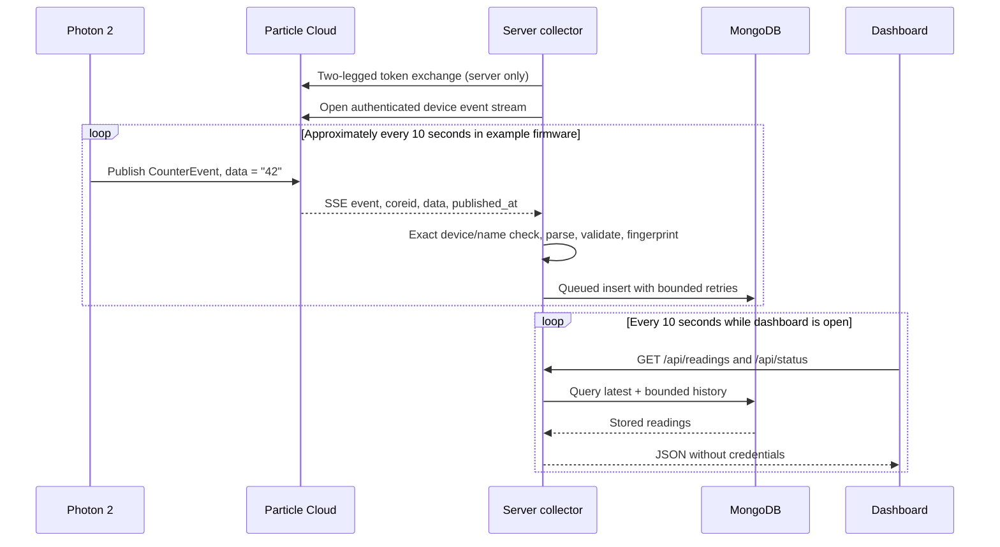

# Data flow

## Event collection

The Particle event-name filter matches prefixes. The application checks the **exact** configured name again. It also verifies the configured device ID even though the stream URL is already device-scoped.

The example accepts `data` as a decimal integer string from 0 to 2,147,483,647 (the nonnegative range of the firmware’s signed 32-bit integer). The event envelope must include `coreid` and a valid `published_at` timestamp. A publication more than five minutes in the future is rejected. Malformed events increment a counter and do not stop subsequent collection.

`publishedAt` is the cloud publication time. `receivedAt` records when the server processed the event. The chart uses publication time; the table displays both times in the viewer’s local timezone. Collector counters start from zero whenever the process starts; seeded mock history and earlier MongoDB records are not counted as newly saved this session.

## Read a variable

`Get counter value` → `GET /api/device/variable` → shared request budget → Particle REST API → firmware variable `counter` → JSON result → variable card.

This is an on-demand observation. It does not insert a history record; history comes from published events. The variable card can differ from the latest event when a reading has changed but has not yet been published or stored.

## Call a function

`Reset counter to 0` → same-origin `POST /api/device/reset` → shared request budget → Particle function `setCounter("0")` → return code.

The firmware updates its counter and requests a new event. The UI reports the function acknowledgement, then refreshes stored history. An acknowledgement does not mean the matching event has already reached MongoDB. If a reset times out, read the variable before trying again: the command might have reached the device.

## Clear the chart

`Clear chart view` sets a timestamp in browser state. Existing plotted records are hidden; later events appear normally. It does not reset the device or delete MongoDB records. Reloading the page or changing the history range restores the stored view. This matches the Node-RED flow’s empty-chart behavior.

## Node-RED mapping

| Original node/behavior           | Application equivalent                                        |
| -------------------------------- | ------------------------------------------------------------- |
| `particle-cloud-subscribe`       | `ParticleClient.stream`, collector started by the server hook |
| Payload transformation function  | `normalizeEvent` in `server/readings.ts`                      |
| MongoDB `insertOne`              | `MongoReadings.insert` through the write queue                |
| `ui_text` Counter Value          | Latest event card                                             |
| `particle-cloud-function`        | Fixed reset endpoint and `ParticleClient.resetCounter`        |
| `particle-cloud-variable`        | Variable endpoint and `ParticleClient.readCounter`            |
| MongoDB `find` / createChartData | Bounded history query and `HistoryChart.svelte`               |
| Empty array to `ui_chart`        | Clear chart view                                              |
| Debug sidebar                    | Collector status, sanitized logs and browser feedback         |

The source flow had chart/history nodes disabled. They are enabled in this template. Its account-wide event subscription has been narrowed to the configured device.
